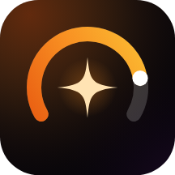
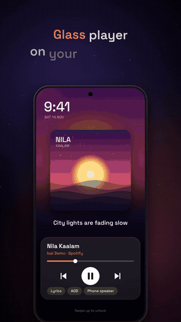
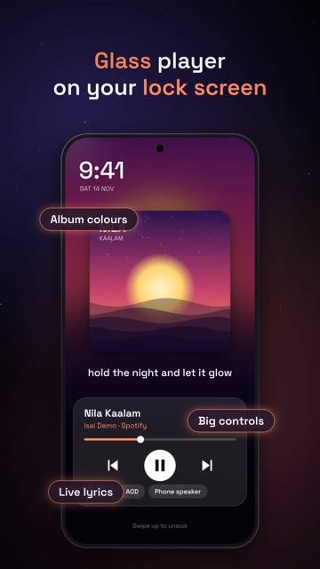
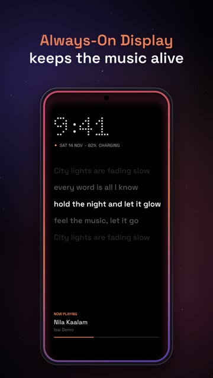
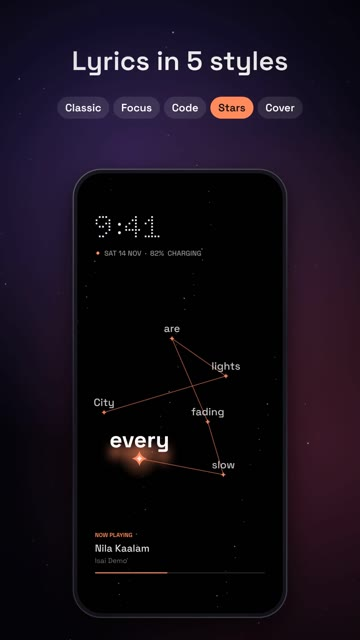
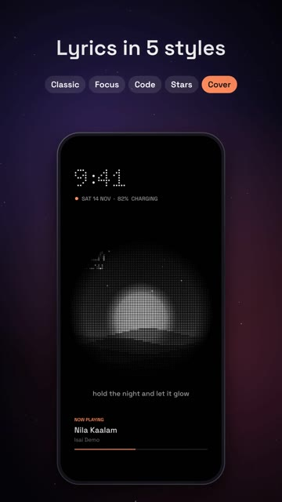
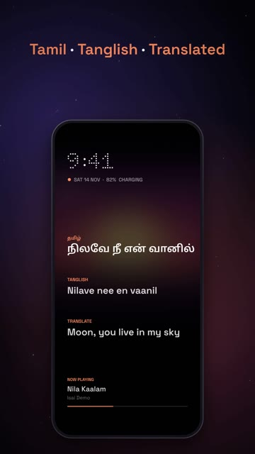
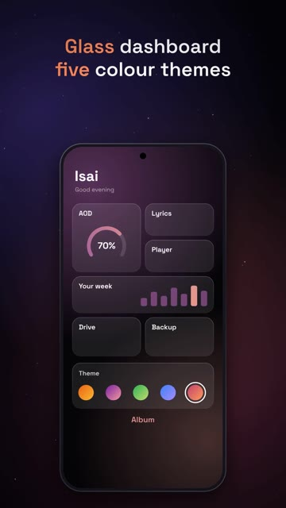

<p align="center">
  
</p>

<h1 align="center">Isai</h1>
<p align="center"><b>Your lock screen, now a music player.</b><br>
Live lyrics, a glass player and an always-on display for the music you already play.</p>

<p align="center">
  <a href="../../releases/latest"><b>⬇ Download the latest APK</b></a> ·
  <a href="PRIVACY.md">Privacy</a> ·
  <a href="../../issues/new/choose">Report a problem</a>
</p>

<p align="center">
  
  <br><a href="docs/video/Isai-promo.mp4">▶ Watch the 1-minute video (with sound)</a>
</p>

---

Isai works with **Spotify, YouTube Music, YouTube, Apple Music** and any app that shows a media notification.
It doesn't play music itself – it shows what's playing on your lock screen and always-on display, with lyrics that move with the song.

## Screens

<p align="center">
  
  
  
</p>
<p align="center">
  
  
  
</p>
<p align="center"><sub>Demo song and artwork made for the preview.</sub></p>

## Features

- **Lock-screen player** – cover, controls, seek and volume, output switch (speaker / buds / car) and a sleep timer, without unlocking.
- **Synced lyrics** – found automatically from LRCLIB, saved for offline use, with timing adjustment and manual choice.
- **Always-on display** – clock, date and battery with lyrics in five styles: **Classic, Focus, Code, Stars** (a night sky with shooting stars) and **Cover** (your album art as a fading dot matrix). Night mode, pocket detection, burn-in protection and a battery guard.
- **Tamil, Tanglish or English** – Tamil script, transliteration, both, or translation for other languages.
- **Glass design** – four colour themes (Sunset, Viola, Luigi, Aurora) or colours from the album art.
- **Your week** – minutes, top songs, top artists, peak hour and streak. Stored only on your phone.
- **Extras** – home-screen widget, Quick Settings tile, drive mode for your car, backup and restore.

## Install

📄 **Step-by-step guide with pictures: [Isai-Install-Guide.pdf](docs/Isai-Install-Guide.pdf)** (English + Tamil)

1. **Turn off Play Protect first** – Play Store → your profile photo → **Play Protect** → ⚙ → turn off **Scan apps with Play Protect** and **Improve harmful app detection**. (Android blocks apps that aren't from the Play Store; you can turn it back on after installing.)
2. Download `Isai-x.y.z.apk` from the [latest release](../../releases/latest).
3. Open it, allow your browser or file manager to **install unknown apps**, then tap **Install → Open**.
4. Follow the welcome tour – it explains every permission. If the *Notification access* switch is greyed out: Settings → Apps → Isai → ⋮ → **Allow restricted settings**.
5. Play a song, then lock your phone.

**Works on any Android phone** with Android 10 or newer – Samsung, Pixel, OnePlus, Xiaomi / Redmi / POCO, Oppo, Realme, Vivo, Motorola, Nothing and more. Setup adapts to your phone maker: it opens your brand's auto-start screen where one exists and links to battery tips for your exact phone.

Updates: open Isai → **About → Check for updates**. Your settings, lyrics and stats are kept.

## Verify your download

Every release lists the APK's **SHA-256**. All releases are signed with this certificate:

`SHA-256: f1:28:93:7a:08:f0:a5:f6:ea:b1:5f:d1:3b:4e:64:c7:32:a5:fe:88:97:99:a4:23:cb:35:a2:4d:f7:0a:bd:1e`

Isai's in-app updater checks both before installing.

```bash
sha256sum Isai-x.y.z.apk                       # must match SHA256SUMS.txt in the release
apksigner verify --print-certs Isai-x.y.z.apk  # certificate SHA-256 must match the release notes
```

## Privacy

No account, no ads, no analytics. Song title, artist, album and length go to [LRCLIB](https://lrclib.net) to find lyrics; lyric lines go to Google Translate only if you turn translation on. Everything else stays on your phone. Details: [PRIVACY.md](PRIVACY.md).

## FAQ

**Why does Isai need notification access?** It's how Android lets an app read what your music app is playing (song, cover, controls). Isai only reads media sessions.

**Why the microphone permission?** Only for the optional *Beat pulse* glow: it reads the music's output level through Android's Visualizer. Nothing is recorded or saved, and it's off by default.

**Lyrics are wrong or missing.** In the player tap *Lyrics → Change* to pick another match, or *Sync − / +* to fix timing. Lyrics come from the LRCLIB community database.

**It stops working after a while.** Set Isai's battery usage to *No restrictions* and follow the tips for your phone brand in *Setup*.

## Feedback

Found a bug or have an idea? [Open an issue](../../issues/new/choose). In Isai, *Troubleshooting → Copy* gives a log you can paste.

---

This repository hosts **release builds only**; the source code is private. See [LICENSE](LICENSE.md). Lyrics © their respective owners, provided by LRCLIB.
